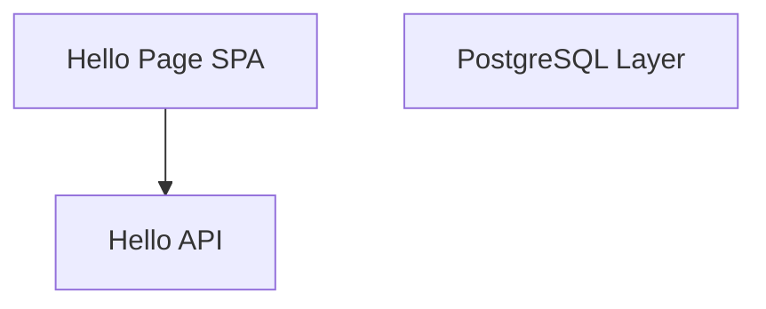
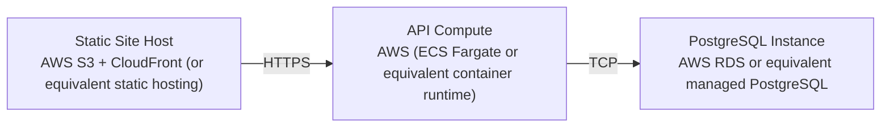

# Architecture

> Maintained by QuorQ AI SDLC. Text between `sdlc:auto` markers is regenerated; anything outside them is yours and is kept.

<!-- sdlc:auto:start narrative -->
## Overview

### ARCH-001 · approved · source: architecture:v1

Overall architecture for the Hello Sample app: a minimal smoke-test web app with one public page that fetches a greeting from a single FastAPI GET /api/hello endpoint and displays it. No authentication, no database tables, no business logic. The React 19 SPA and FastAPI 0.115 API are served from separate origins on AWS. PostgreSQL 16 is provisioned so the delivery pipeline exercises its full standard path, though the app never queries it.

Approved architecture, version 1. The system consists of three components (web SPA, API, database), one endpoint (GET /api/hello), and three AWS deployment nodes (static site host, API compute, PostgreSQL instance). The app's sole purpose is to smoke-test the delivery pipeline.

**Related:** US-001, US-002

### ARCH-002 · approved · source: architecture:v1

Web component: Hello Page SPA built with React 19. Renders a single public page that fetches the greeting from GET /api/hello and displays the returned message. Reads the API base URL from VITE_API_BASE_URL.

Component key: web. Name: Hello Page SPA (React 19). Responsibility: render a single public page that fetches the greeting from GET /api/hello and displays the returned message. The SPA reads the API base URL from the VITE_API_BASE_URL environment variable. No authentication, no routing to other pages.

**Related:** US-001, US-002

### ARCH-003 · approved · source: architecture:v1

API component: Hello API built with FastAPI 0.115. Exposes a public GET /api/hello endpoint returning JSON {"message": "Hello from Quorq"} with HTTP 200 and Content-Type application/json. No auth, no parameters.

Component key: api. Name: Hello API (FastAPI 0.115). Responsibility: expose a public GET /api/hello endpoint returning a hardcoded JSON greeting object {"message": "Hello from Quorq"} with HTTP 200 and Content-Type application/json. No authentication and no parameters required.

**Related:** US-001, US-002

### ARCH-004 · approved · source: architecture:v1

Database component: PostgreSQL 16 layer provisioned by the pipeline to exercise the standard database path. No tables, no queries. Present so deployment tooling validates its full provisioning flow.

Component key: db. Name: PostgreSQL Layer (PostgreSQL 16). Responsibility: provisioned by the pipeline to exercise the standard database provisioning path. No tables are created and no queries are issued by the application. Its sole purpose is to validate that the deployment tooling can provision a PostgreSQL instance end-to-end.

**Related:** US-001, US-002

### ARCH-005 · approved · source: architecture:v1

Critical path: a visitor loads the Hello page and sees the greeting message.

Path: Visitor loads Hello page and sees greeting. Steps: (1) A visitor opens the public Hello page in a browser. (2) The React SPA reads VITE_API_BASE_URL. (3) The SPA fetches GET /api/hello. (4) The API returns {"message": "Hello from Quorq"}. (5) The SPA renders the message so it stays visible.

**Related:** US-001, US-002

### ARCH-006 · approved · source: architecture:v1

Single API endpoint definition: GET /api/hello returns a hardcoded greeting JSON object.

Endpoint: GET /api/hello. Returns a hardcoded greeting JSON object {"message": "Hello from Quorq"}. HTTP 200, Content-Type application/json. No authentication or parameters required.

**Related:** US-001, US-002

### ARCH-007 · approved · source: architecture:v1

Three AWS deployment nodes: a static site host for the React SPA, a container runtime for the FastAPI API, and a managed PostgreSQL instance.

Deployment nodes: (1) Static Site Host — AWS S3 + CloudFront (or equivalent static hosting), serves the React 19 static build. (2) API Compute — AWS ECS Fargate (or equivalent container runtime), runs FastAPI 0.115 on uvicorn. (3) PostgreSQL Instance — AWS RDS (or equivalent managed PostgreSQL), PostgreSQL 16. The SPA and API are served from separate origins.

**Related:** US-001, US-002

### ARCH-008 · approved · source: architecture:v1

Four approved technology decisions covering backend, frontend, database, and cloud provider.

Technology decisions (all approved stack):
- Backend: FastAPI 0.115 (alternative considered: Flask). Rationale: a single GET /api/hello endpoint returning a JSON greeting is a few lines of FastAPI and matches the platform's standard backend path.
- Frontend: React 19 (alternative considered: Plain HTML). Rationale: React is the platform frontend option and easily fetches and renders the greeting on one page.
- Database: PostgreSQL 16 (alternative considered: No database). Rationale: no data is stored, but the pipeline expects a PostgreSQL layer so provisioning it validates the full standard deployment path.
- Cloud: AWS (alternative considered: Other clouds). Rationale: AWS provides the standard web deployment primitives needed for a static SPA and a containerized API.

**Related:** US-001, US-002
<!-- sdlc:auto:end narrative -->

<!-- sdlc:auto:start building-blocks -->
## Building Block View

| ID | Name | Technology | Responsibility | Depends on |
|---|---|---|---|---|
| web | Hello Page SPA | React 19 | Render a single public page that fetches the greeting from GET /api/hello and displays the returned message. Reads the API base URL from VITE_API_BASE_URL. | api |
| api | Hello API | FastAPI 0.115 | Expose a public GET /api/hello endpoint returning JSON {"message": "Hello from Quorq"} with HTTP 200 and Content-Type application/json. No auth, no parameters. | — |
| db | PostgreSQL Layer | PostgreSQL 16 | Provisioned by the pipeline to exercise the standard database path. No tables, no queries. Present so deployment tooling validates its full provisioning flow. | — |

<!-- sdlc:auto:end building-blocks -->

<!-- sdlc:auto:start runtime -->
## Runtime View

### Visitor loads Hello page and sees greeting

A visitor opens the public Hello page in a browser. The React SPA reads VITE_API_BASE_URL, fetches GET /api/hello, receives {"message": "Hello from Quorq"}, and renders the message so it stays visible.

- **Components:** web, api
- **Modules:** src/pages/Hello, app/hello
- **Key functions:** GET /api/hello -> {message: str}, fetchGreeting(), render()
<!-- sdlc:auto:end runtime -->

<!-- sdlc:auto:start deployment-view -->
## Deployment View

| Name | Service | Runtime | Scaling | Environment |
|---|---|---|---|---|
| Static Site Host | AWS S3 + CloudFront (or equivalent static hosting) | React 19 static build | Managed CDN, no scaling config needed | dev |
| API Compute | AWS (ECS Fargate or equivalent container runtime) | FastAPI 0.115 on uvicorn | Single task sufficient for smoke test | dev |
| PostgreSQL Instance | AWS RDS or equivalent managed PostgreSQL | PostgreSQL 16 | Smallest instance class sufficient | dev |

| Source | Target | Protocol |
|---|---|---|
| Static Site Host | API Compute | HTTPS |
| API Compute | PostgreSQL Instance | TCP |

<!-- sdlc:auto:end deployment-view -->

<!-- sdlc:auto:start decisions -->
## Architecture Decisions

| Layer | Choice | ADR |
|---|---|---|
| Backend | FastAPI 0.115 | [ADR-0001](adr/backend.md) |
| Frontend | React 19 | [ADR-0002](adr/frontend.md) |
| Database | PostgreSQL 16 | [ADR-0003](adr/database.md) |
| Cloud | AWS | [ADR-0004](adr/cloud.md) |
<!-- sdlc:auto:end decisions -->

<!-- sdlc:auto:start links -->
## Related Documents

- [Data Model](data-model.md)
- [API Specification](api/openapi.yaml)
- [Architecture Decision Records](adr/README.md)
<!-- sdlc:auto:end links -->
