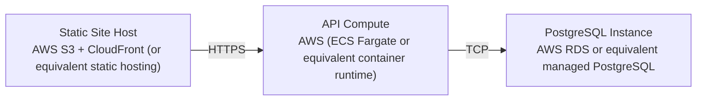

# Deployment Guide

> Maintained by QuorQ AI SDLC. Text between `sdlc:auto` markers is regenerated; anything outside them is yours and is kept.

<!-- sdlc:auto:start how-it-deploys -->
Pushes to `main` run `.github/workflows/deploy.yml`, which builds the API image (if there is a backend) and deploys the SPA to AWS Amplify. Commits touching only `docs/sdlc/**` don't deploy. Deployments can also be started from the platform's Deployment tab.
<!-- sdlc:auto:end how-it-deploys -->

<!-- sdlc:auto:start environments -->
| Name | Service | Runtime | Scaling | Environment |
|---|---|---|---|---|
| Static Site Host | AWS S3 + CloudFront (or equivalent static hosting) | React 19 static build | Managed CDN, no scaling config needed | dev |
| API Compute | AWS (ECS Fargate or equivalent container runtime) | FastAPI 0.115 on uvicorn | Single task sufficient for smoke test | dev |
| PostgreSQL Instance | AWS RDS or equivalent managed PostgreSQL | PostgreSQL 16 | Smallest instance class sufficient | dev |
<!-- sdlc:auto:end environments -->

<!-- sdlc:auto:start live -->
**Frontend URL:** https://paaca6f73722d.d3j61xaup4zgrx.amplifyapp.com

**Database:** — · —

**Version:** 872f79c4e5a6

**Commit:** `872f79c`

**Finished:** 2026-11-20
<!-- sdlc:auto:end live -->

<!-- sdlc:auto:start topology -->

<!-- sdlc:auto:end topology -->
